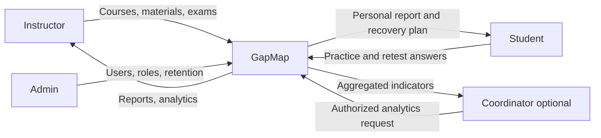
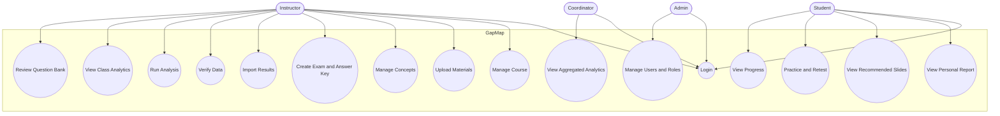
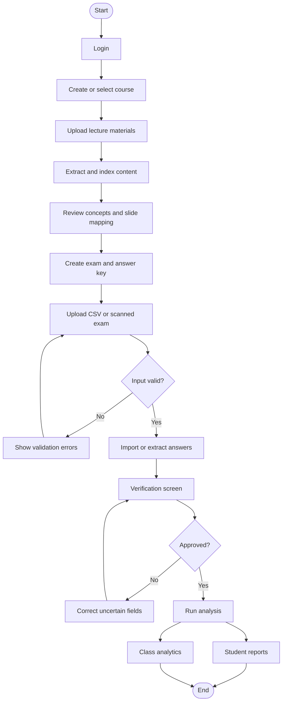
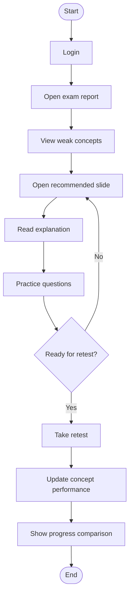
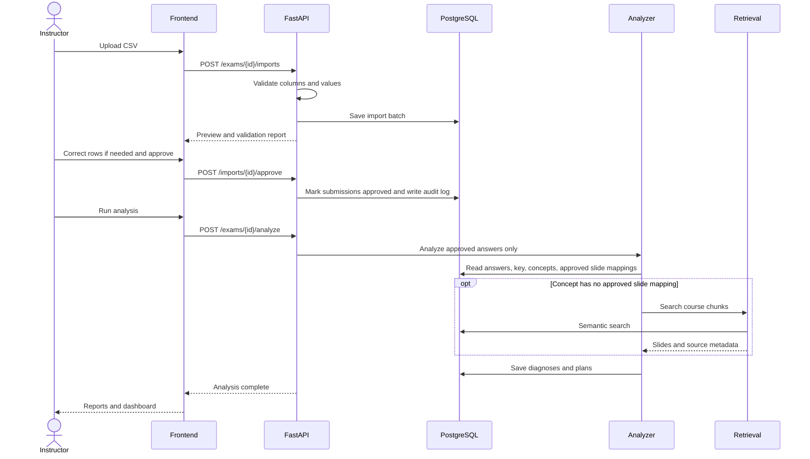
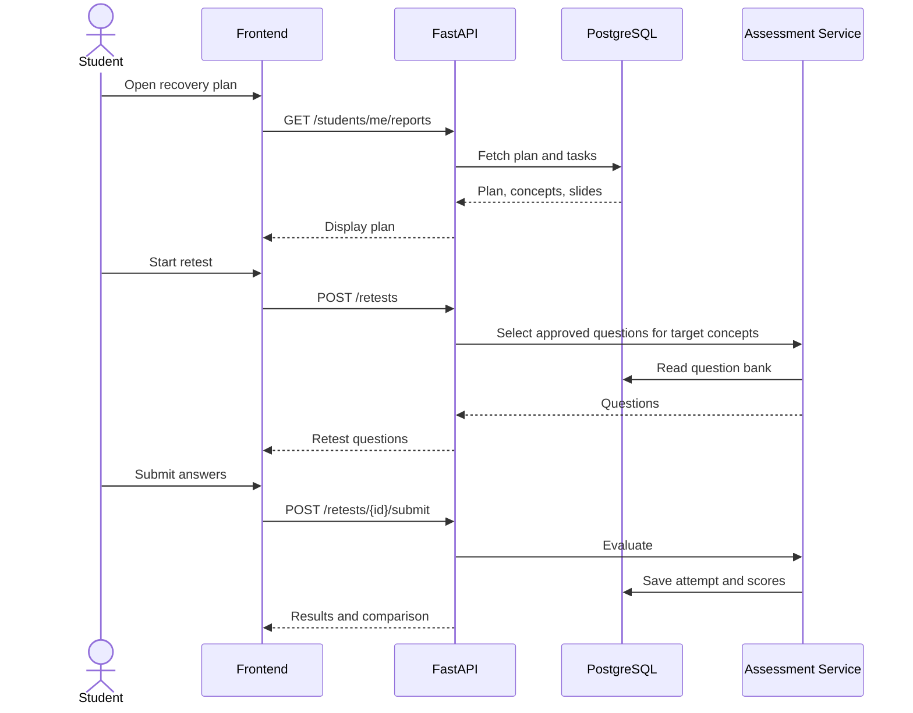
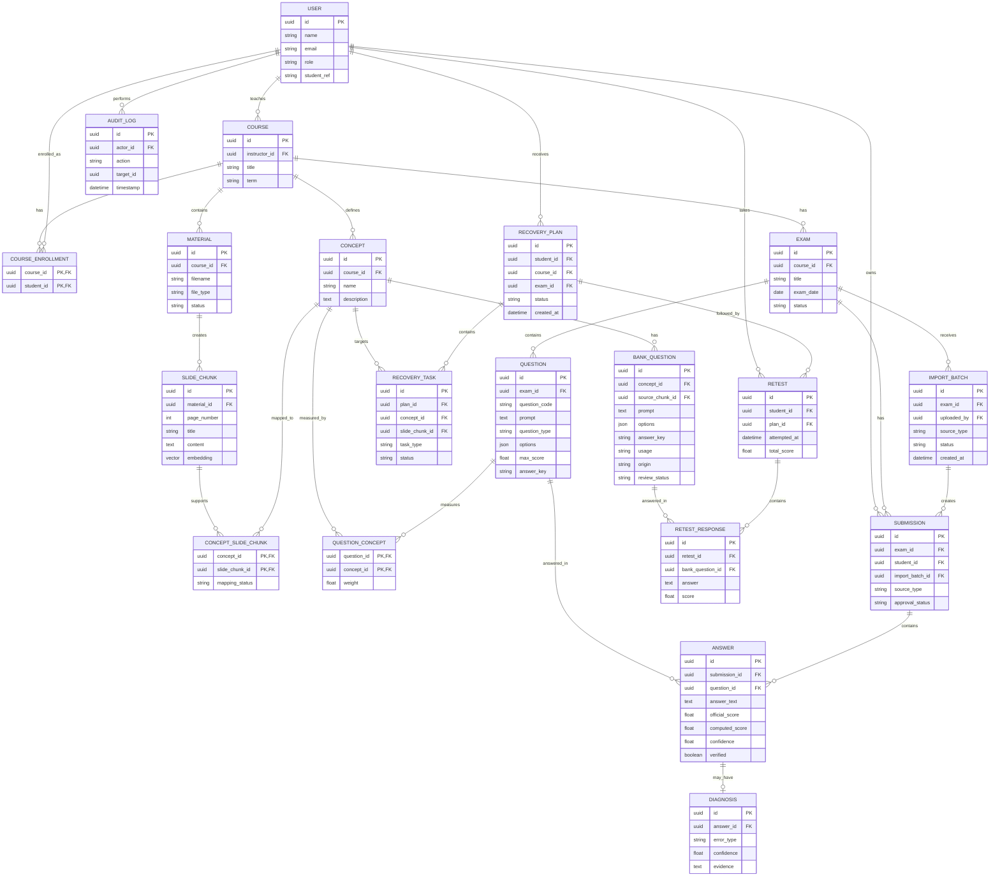
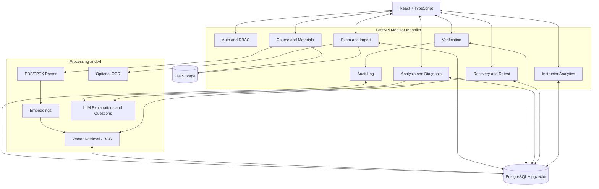

# GapMap — Complete Project Analysis & Implementation Plan

**AI Educathon 2026 | Alamein International University**
**Document version:** 1.1 (reviewed and revised; project renamed to GapMap) — November 13, 2026
**Event date:** November 28, 2026

> This document is the team's single reference from Requirements through Implementation, Testing, and the Final Demo.
> The original Blueprint (*EduRescue AI Project Blueprint*, the project's earlier name) is the source of the project idea and scope. Any extra implementation details added here (IDs, API endpoints, tables, the daily schedule, repository structure) are practical proposals that the team must confirm with the supervising instructor.
> A summary of what changed in v1.1 is listed in **Appendix A**.

---

# 0. Way of Working

Follow this order: **Problem → Requirements → Analysis & Diagrams → Design → Implementation → Testing → Deployment → Final Presentation**.

Do not start with many features. First make **one complete scenario** work end to end: from uploading data to the student report and the Retest.

# 1. Project Overview

## 1.1 The Idea

GapMap is a platform that turns an exam result from a plain grade into a diagnosis of the student's weak points. It recommends specific parts of the lectures to review, gives the student targeted practice and a follow-up test, and at the same time shows the instructor which concepts most of the class struggles with.

## 1.2 Problem Statement

A student receives a grade or a corrected paper, but does not necessarily know:
- Which concept did I get wrong?
- Is the problem understanding the concept, applying a formula, doing the calculation, or missing prerequisites?
- Which lecture, and which slide/page, should I review?
- How can I check that I actually understood it after reviewing?

The instructor, in turn, cannot manually analyze every student's mistakes and discover which concepts need to be re-explained.

## 1.3 Proposed Solution

1. The instructor creates a Course and uploads the lectures.
2. The instructor adds the Answer Key or Rubric.
3. The instructor uploads exam results as CSV/Excel (the primary path) or corrected papers as PDF/Images (optional).
4. The system imports/extracts the answers and scores and shows them for review.
5. The system links each question to a Concept and to real slides/pages from the lectures.
6. The system analyzes the mistakes and suggests a likely cause supported by evidence.
7. The system creates a personal Recovery Plan for the student.
8. The student reviews, solves Practice questions, and then takes a Retest.
9. The instructor sees Class Analytics showing the concepts that cause the most errors.

## 1.4 Value Proposition

| User | Value |
|---|---|
| Student | Knows their weak points, where to review, and which practice fits them |
| Instructor | Knows the recurring errors and the topics that need re-teaching |
| University/Coordinator | Aggregated indicators that help improve learning |

## 1.5 Why Not Just a Regular Chatbot?

The system starts from **actual, approved exam results**. It links each mistake to a concept and to a slide from the instructor's own materials, and it provides a recovery plan, practice, and a follow-up test, together with class-level analytics.

# 2. Scope

## 2.1 MVP — Must Be Built

Each item is tagged with its priority (see the Priority Backlog in Section 17).

- One pilot course. **(P0)**
- PDF lectures, preserving the file name and page number. **(P0)**
- One structured exam type; the recommended choice is MCQ. **(P0)**
- CSV/Excel as the primary input path. **(P0)**
- Answer Key entered by the instructor. **(P0)**
- Mapping of questions to concepts, and of concepts to slides. **(P0)**
- Calculation of each student's performance per Concept. **(P0)**
- Student Report + Recovery Plan. **(P0)**
- Recommended slides with the real source (file + page). **(P0)**
- Practice questions and a short Retest, taken from a **pre-approved question bank**. **(P0)**
- Instructor Dashboard with aggregated errors. **(P0)**
- Verification/Approval for unconfirmed data. **(P0)**
- LLM-generated grounded explanation and LLM-generated practice questions (reviewed before use). **(P1)**

> **Why this split:** the MVP must still work end to end if the LLM is unavailable. The deterministic core (scoring, concept performance, slide references, a pre-approved question bank) is P0; the LLM only improves explanations and question variety (P1).

## 2.2 Out of MVP Scope

- Guaranteed OCR for every handwriting style.
- Automatic grading of long essays.
- Support for all courses and faculties.
- LMS integration.
- Predicting failure and academic risk.
- A fully automatic, comprehensive Knowledge Graph.
- Native mobile app.
- Admin UI for user management (for the MVP, users and roles are created with a seed script; see Section 3).

## 2.3 OCR Decision

The Blueprint recommends CSV/Excel as the most reliable path for the MVP. OCR for corrected papers is an extra, high-risk feature. **The success of the system must not depend on OCR or on understanding handwriting.**

# 3. Stakeholders & Roles

| Actor | Permissions and Responsibilities |
|---|---|
| System Admin | Manages accounts, roles, and data retention |
| Instructor | Creates the course, uploads content, sets up the exam and the answer key, approves data, views analytics |
| Student | Views their own report, slides, review plan, practice, and Retest |
| Course Coordinator (optional) | Views authorized aggregated indicators |

Access rules:
- A student sees only their own data.
- An instructor sees only the courses and students they are authorized for.
- A coordinator sees aggregated analytics according to their permission.
- Any access to sensitive data is limited and logged.

**Account provisioning (MVP assumption):** user accounts and roles are created by a seed script or a roster import. A student's `student_ref` in the CSV must match the `student_ref` of an existing, enrolled user account. A full Admin screen is out of MVP scope.

# 4. Requirements Engineering

## 4.1 Functional Requirements

### Authentication & Authorization
- **FR-01:** User login.
- **FR-02:** Assign a Role to every user.
- **FR-03:** Prevent a student from seeing another student's data.
- **FR-04:** Prevent access to a course the user is not authorized for.

### Course & Materials
- **FR-05:** The instructor creates a Course.
- **FR-06:** Upload PDF files; PPTX support depending on available time (P1).
- **FR-07:** Extract text together with the file name and page/slide number.
- **FR-08:** Split the content into searchable Chunks.
- **FR-09:** The instructor reviews/edits the mapping between content and concepts.
- **FR-10:** Define Concepts, describe them, and link them to content.

### Exam & Import
- **FR-11:** Create an Exam linked to a course.
- **FR-12:** Define the questions, their types, and their scores.
- **FR-13:** Add an Answer Key or Rubric.
- **FR-14:** Import CSV/Excel.
- **FR-15:** Validate the columns and the data before importing.
- **FR-16:** Link every Submission to a student identifier.
- **FR-17:** Store the source of each score and its status (approved / pending review).
- **FR-18:** Support PDF/Image for corrected papers as an additional path (optional, P2).

### Extraction & Verification
- **FR-19:** Extract the answer and score of each question.
- **FR-20:** Store a Confidence value for each field when OCR is used (optional OCR path).
- **FR-21:** Show the original source next to the extracted data.
- **FR-22:** Allow the instructor to correct and approve the data.
- **FR-23:** Do not run final analysis on unapproved data.

### Analysis & Diagnosis
- **FR-24:** Compare MCQ answers with the Answer Key.
- **FR-25:** Link each question to one or more concepts (the MVP uses one primary concept per question; see Section 12).
- **FR-26:** Calculate the student's performance per concept.
- **FR-27:** Suggest an Error Type when evidence exists.
- **FR-28:** Error types: Conceptual, Formula/Application, Calculation, Missing Prerequisite, Incomplete Answer.
- **FR-29:** Present the diagnosis as a possibility, not a fact, when evidence is insufficient.
- **FR-30:** Aggregate errors at the class level.

### RAG & Recovery
- **FR-31:** Search only the approved course materials.
- **FR-32:** Return the file name and page/slide number.
- **FR-33:** Show an excerpt or an image of the source.
- **FR-34:** Explain why the source was recommended.
- **FR-35:** Do not invent a source when no suitable result is found.
- **FR-36:** Create a personal review plan ordered by priority.
- **FR-37:** Show the concept and the recommended slides.
- **FR-38:** Provide an explanation based on the course materials.
- **FR-39:** Provide new practice questions on the same concept (from the approved question bank; LLM-generated questions are P1 and must be flagged and reviewed).
- **FR-40:** The student marks an activity as completed.
- **FR-41:** Create a short Retest.

### Progress & Analytics
- **FR-42:** Store Retest attempts.
- **FR-43:** Compare performance before and after, on questions that are as equivalent as possible.
- **FR-44:** Show improvement as an indicator, not as conclusive proof of mastery.
- **FR-45:** A Dashboard showing performance by question and by concept.
- **FR-46:** Identify the concepts most frequently involved in errors.
- **FR-47:** Suggest topics for re-teaching, with evidence.

## 4.2 Non-Functional Requirements

- **NFR-01 Security:** Role-Based Access Control.
- **NFR-02 Privacy:** Use a pseudonymous Student Reference wherever possible.
- **NFR-03 Protection:** Encrypt data in transit and at rest, according to the deployment environment.
- **NFR-04 Explainability:** Every diagnosis is linked to the question, the answer, the concept, and the source.
- **NFR-05 Reliability:** An OCR/LLM failure must not break the CSV path and the core analysis.
- **NFR-06 Accuracy:** Low-confidence data requires human review.
- **NFR-07 Usability:** Simple and clear interfaces.
- **NFR-08 Maintainability:** A Modular Monolith with separate modules.
- **NFR-09 Performance:** Measure the actual processing time on the demo dataset.
- **NFR-10 Auditability:** Log approvals and important edits.
- **NFR-11 Deployment:** Repeatable runs using Docker Compose.
- **NFR-12 Responsible AI:** No automatic modification of official grades and no definitive diagnosis without evidence.

## 4.3 Business Rules

- **BR-01:** An official grade changes only with the instructor's approval.
- **BR-02:** An approved Answer Key/Rubric must exist before evaluation.
- **BR-03:** In the MVP, every question is linked to at least one concept.
- **BR-04:** Every slide recommendation has a real reference.
- **BR-05:** A student does not see anyone else's data.
- **BR-06:** Low-confidence OCR = Pending Verification.
- **BR-07:** The cause of an error is a Hypothesis, and "Unknown" is an allowed value.
- **BR-08:** Retest questions are new and target the same concept.
- **BR-09:** Do not use student data to train an external model without authorization.
- **BR-10 (added):** Retest questions must differ from the original exam questions and from the Practice questions, so the Retest does not measure memorization.
- **BR-11 (added):** Any AI-generated question is flagged as AI-generated and has a review status; only approved questions are served to students.
- **BR-12 (added):** Data sent to an external LLM contains only the question, the concept, and the retrieved lecture text. It never contains student names, emails, or references.

## 4.4 Acceptance Criteria

- The instructor creates a Course and uploads a PDF.
- The system stores the text and the page number.
- The instructor creates an Exam and an Answer Key.
- A valid CSV is imported, and an invalid one is rejected with a clear message.
- Analysis cannot run on data that is not approved (added).
- The system calculates the performance per Concept.
- The system returns real Slides.
- The student sees the Recovery Plan and takes the Retest.
- The Retest result is saved and compared with the original performance (added).
- A student cannot open another student's report (added).
- The instructor sees Class Analytics.
- Official grades are never changed automatically.

# 5. Assumptions, Constraints & Decisions

## Assumptions

- An Instructor/Subject Matter Expert is available to review the concepts.
- The lecture materials are available and permitted for use.
- An Answer Key or approved grades are available.
- Synthetic or anonymized data can be used.
- We start with one course and one structured exam.

## Constraints

- Implementation time until November 28 is limited.
- OCR for handwriting is not guaranteed.
- A wrong MCQ answer does not always reveal the reason for the mistake.
- The quality of RAG depends on the quality of the content and the concept mapping.
- No target accuracy is proven before testing.
- With few questions per concept, per-concept percentages are coarse; always show how many questions they are based on (added).

## Day-One Decisions

- [ ] Choose the course and the instructor.
- [ ] Approve MCQ as the first exam type.
- [ ] Approve CSV as the primary path.
- [ ] Fix the CSV columns (the Long Format is recommended; see Section 9.6).
- [ ] Obtain the Answer Key.
- [ ] Define the Concepts (3–5 for the pilot).
- [ ] Obtain the lecture files.
- [ ] Link the questions to the slides.
- [ ] Choose the LLM and the privacy policy.
- [ ] Define the demo data.
- [ ] Design the Retest and how the improvement is calculated.
- [ ] Decide who builds the pre-approved practice/Retest question bank and by when (added).

# 6. User Stories

| ID | As a | I want | So that |
|---|---|---|---|
| US-01 | Instructor | to create a Course | I can set up the subject |
| US-02 | Instructor | to upload a Lecture PDF | the content becomes searchable |
| US-03 | Instructor | to define Concepts | I can link questions to topics |
| US-04 | Instructor | to create an Exam and an Answer Key | the system knows the correct answers |
| US-05 | Instructor | to upload a CSV | I can enter the students' results |
| US-06 | Instructor | to review the data | I can correct import/OCR errors |
| US-07 | Student | to view my report | I know my weak points |
| US-08 | Student | to open the recommended Slides | I review from the right source |
| US-09 | Student | to solve Practice questions | I can train on the concepts |
| US-10 | Student | to take a Retest | I can measure my improvement |
| US-11 | Instructor | to view Class Analytics | I know the difficult topics |
| US-12 | Admin | to manage permissions | I can protect the data |

# 7. Main Workflows

## 7.1 Instructor
Login → Create Course → Upload Materials → Extract/Index Pages → Review Concepts → Create Exam → Add Answer Key → Upload Results → Verify/Approve → Run Analysis → View Reports & Analytics.

## 7.2 Student
Login → Open Report → View Weak Concepts → Open Recommended Slides → Read Explanation → Practice → Retest → View Progress.

## 7.3 Course Ingestion
Upload PDF/PPTX → Validate → Extract Text → Preserve Page/Slide → Chunk → Create Embeddings → Store Index → Instructor Review.
(Also store or render a page image for each page, so the Slide Viewer can show the real slide: see FR-33.)

## 7.4 CSV Import
Upload CSV → Validate Template → Validate Student/Question IDs → Match Answer Key → Import → Preview Errors → Instructor Approval → Analysis.

## 7.5 Optional OCR
Upload Scan → Image Preprocessing → OCR/Layout Detection → Extract Answers/Marks + Confidence → Verification Screen → Instructor Approval → Analysis.

## 7.6 Analysis
Approved Submission → Compare Answer Key → Map Question to Concept → Calculate Concept Performance → Suggest Error Pattern → Attach Slides (from the instructor-approved Concept→Slide mapping, with semantic search only as a fallback) → Save Evidence-backed Diagnosis.

> **Why:** the Concept→Slide mapping is prepared during course setup (RAG suggests, the instructor approves). This keeps the core analysis fast, deterministic, and independent of the LLM.

## 7.7 Recovery
Weak Concepts → Rank Priorities → Retrieve Slides → Grounded Explanation → Practice → Retest → Update Progress.

## 7.8 Analytics
Approved Results → Aggregate by Question/Concept → Identify Frequent Errors → Dashboard → Re-teaching Suggestions.

# 8. Diagrams (Mermaid)

Copy the code blocks into the Mermaid Live Editor or Draw.io to redraw them. These are proposed Analysis diagrams and can be edited.

## 8.1 Context Diagram


## 8.2 Use Case Diagram


## 8.3 Activity — Instructor


## 8.4 Activity — Student


## 8.5 Sequence — CSV Import and Analysis


## 8.6 Sequence — Student Retest


## 8.7 ERD


**ERD Notes:**
- This is a proposed Logical Model; finalize it after the CSV format and the Retest design are approved.
- Many-to-many relationships are modeled with the junction tables `QUESTION_CONCEPT` and `CONCEPT_SLIDE_CHUNK`.
- `QUESTION.question_code` (for example `Q1`) is the identifier used in the CSV. The CSV never contains database UUIDs.
- `ANSWER` keeps two separate scores: `official_score` (provided by the instructor in the CSV, optional) and `computed_score` (calculated by the system). They must never be mixed (BR-01). A mismatch between them is flagged during verification.
- `BANK_QUESTION` stores practice and Retest questions. `usage` is `practice` or `retest`, `origin` is `instructor` or `ai`, and `review_status` is `pending` or `approved`. Only approved questions are served to students (BR-11).
- `CONCEPT_SLIDE_CHUNK.mapping_status` is `suggested` or `approved`.
- `ANSWER.confidence` is used only on the OCR path.

## 8.8 Architecture


# 9. Technical Design

## 9.1 Architecture Style
**Modular Monolith:** a single backend with clear modules. It is simpler and faster than Microservices for the MVP, and it can be split later if needed.

## 9.2 Suggested Stack

| Layer | Technology | Purpose |
|---|---|---|
| Frontend | React + TypeScript | Student/Instructor UI |
| Styling | Tailwind CSS (suggestion) | UI styling |
| Backend | Python + FastAPI | REST API |
| ORM & Migrations | SQLAlchemy + Alembic (added) | Data access and schema versioning |
| Database | PostgreSQL | Core data |
| Vector Search | pgvector | Semantic search |
| Auth | JWT + password hashing (added) | Login and RBAC |
| PDF | PyMuPDF | Text + page extraction, and page rendering to images |
| PPTX | python-pptx | Slide extraction (P1) |
| CSV/Excel | pandas + openpyxl (added) | Import and validation |
| Background jobs | FastAPI BackgroundTasks, or RQ/Celery if needed (added) | Material processing (the status endpoint assumes async work) |
| File storage | Local Docker volume (or MinIO) (added) | Uploaded files and page images |
| Image | OpenCV (optional) | Image preprocessing |
| OCR | PaddleOCR/Tesseract initially | Printed text extraction; test language support |
| Embeddings | A multilingual embedding model if lectures contain Arabic (added) | Semantic search |
| LLM | API or suitable local model | Grounded explanation and question generation |
| Concept Graph | NetworkX (optional) | Concept relationships |
| Testing | pytest (backend), Vitest/Playwright (optional, frontend) (added) | Automated tests |
| Deployment | Docker Compose | Reproducible demo |

## 9.3 Backend Modules
`auth`, `courses`, `materials`, `concepts`, `exams`, `imports`, `verification`, `analysis`, `retrieval`, `recovery`, `question_bank` (added), `analytics`, `audit`.

## 9.4 Frontend Pages

**Instructor:** Login, Dashboard, Courses, Course Details, Materials Upload, Concept Mapping, Exams, Exam Builder, Answer Key, CSV Import, Verification, Analysis Results, Class Analytics.

**Student:** Login, Dashboard, My Courses, Exam Report, Weak Concepts, Slide Viewer, Recovery Plan, Practice Quiz, Retest, Progress.

> **MVP screen cut (added):** the list above is about 23 screens, which is a lot for a 15-day schedule. For the MVP, merge them into this must-have set:
> - **Instructor:** Login · Course Details (with Materials Upload) · Concept Mapping · Exam Builder + Answer Key · CSV Import + Verification · Class Analytics.
> - **Student:** Login · Exam Report (with Weak Concepts) · Slide Viewer · Practice/Retest · Progress.

## 9.5 Initial API Contract

| Method | Endpoint | Purpose |
|---|---|---|
| POST | `/api/auth/login` | Login |
| GET | `/api/me` | Current user |
| GET/POST | `/api/courses` | List/create courses |
| GET | `/api/courses/{id}` | Course details |
| POST | `/api/courses/{id}/materials` | Upload material |
| GET | `/api/materials/{id}/status` | Processing status |
| GET | `/api/materials/{id}/pages/{page}` | Page text and image for the Slide Viewer *(added)* |
| GET/POST | `/api/courses/{id}/concepts` | Concepts |
| POST | `/api/concepts/{id}/slides` | Map slides |
| GET/POST | `/api/courses/{id}/exams` | Exams |
| POST | `/api/exams/{id}/questions` | Add question (with concept link) |
| PUT | `/api/questions/{id}/answer-key` | Answer key |
| POST | `/api/exams/{id}/imports` | Import CSV |
| GET | `/api/imports/{id}` | Import preview and validation report |
| PATCH | `/api/imports/{id}/rows/{row_id}` | Correct a row during verification *(added; FR-22)* |
| POST | `/api/imports/{id}/approve` | Approve data |
| POST | `/api/imports/{id}/reject` | Reject an import *(added)* |
| POST | `/api/exams/{id}/analyze` | Run analysis |
| GET | `/api/students/me/reports` | Student reports |
| GET | `/api/recovery-plans/{id}` | Recovery plan |
| POST | `/api/recovery-tasks/{id}/complete` | Mark an activity as completed *(added; FR-40)* |
| GET | `/api/concepts/{id}/practice` | Approved practice questions *(added)* |
| GET/POST | `/api/concepts/{id}/bank-questions` | Review/add question-bank items *(added)* |
| POST | `/api/retests` | Create retest (takes `recovery_plan_id`) |
| POST | `/api/retests/{id}/submit` | Submit retest |
| GET | `/api/retests/{id}/results` | Retest result |
| GET | `/api/courses/{id}/analytics` | Class analytics |
| GET | `/api/courses/{id}/audit-log` | Audit log (P1) *(added)* |

These endpoints are proposed for coordination and may change before implementation.

## 9.6 CSV Template

**Decision (recommended): use the Long Format as the single primary format.** It extends naturally to more question types and to partial data, and each row is validated independently.

| student_ref | question_id | answer | score |
|---|---|---|---:|
| STU001 | Q1 | B | 1 |
| STU001 | Q2 | A | 0 |
| STU002 | Q1 | B | 1 |
| STU002 | Q2 | C | 0 |

- `student_ref` must match an enrolled student's reference (a pseudonymous reference).
- `question_id` must match a `question_code` of the selected exam (for example `Q1`).
- `answer` is the student's selected option. It must be one of the question's options.
- `score` is **optional**. When present, it is stored as the instructor's `official_score`; the system's own result is stored separately as `computed_score` (see Section 8.7).
- Wide Format (`student_ref, Q1, Q2, Q3`) is acceptable if manual entry is much easier, but the team must pick one format and freeze it. Do not support both in the MVP.
- Do not mix an instructor-approved score with an automatically suggested one.

**Validation rules (see also TC-05 to TC-08):** required columns present; no empty `student_ref`; known `student_ref` and `question_id`; no duplicate (student, question) rows; the answer is within the question's options; the score does not exceed `max_score`; unsupported file types are rejected with a clear message.

# 10. AI Components

## 10.1 OCR / Document AI
Input: PDF/Image.
Processing: image enhancement, answer and score extraction, Confidence.
Output: structured data for review.
In the MVP: CSV first; OCR is a limited additional path.

## 10.2 Concept Mapping
Linking a question to the concept it assesses. In the first version, it is better for the instructor to review/approve the mapping manually rather than rely on AI alone.

The same applies to **Slide Mapping** (linking a concept to the slides that explain it): RAG suggests candidate slides, and the instructor approves them (`mapping_status = approved`).

## 10.3 Error Classification
Proposed types: Conceptual misunderstanding, Formula application, Calculation, Missing prerequisite, Incomplete answer.
A wrong MCQ choice does not always reveal the cause; show a "Likely explanation" or "Unknown" depending on the evidence.

## 10.4 RAG in Simple Terms
1. Extract the text of every page/slide.
2. Split it into Chunks.
3. Create Embeddings.
4. Store the text, the Embedding, the file name, and the page number.
5. Search for the parts related to the concept.
6. Send the retrieved parts to the model so it explains based on them.
7. Show the real source to the student.

**Rule:** never invent a lecture name, a slide number, or content that does not exist. If nothing suitable is found, say so (FR-35, TC-12).

**Security note (added):** treat extracted lecture text and student answers as data, never as instructions. Instruct the model to ignore any commands found inside them (prompt-injection mitigation).

## 10.5 Recovery Plan
Inputs: weak concepts, the student's performance, the linked slides, and prerequisites if any.
Outputs: prioritized order, slides, a source-grounded explanation, and Practice Questions.

**Fallback when the LLM is unavailable (added):** show the approved slide(s) with the extracted excerpt, plus practice questions from the approved question bank. The plan is still complete, only without the generated explanation.

## 10.6 Retest
Compare the student's performance before and after on the same concepts, with new and as-equivalent-as-possible questions. The result is an early indicator, not proof of long-term mastery.

# 11. Data Model

| Entity | Important Fields |
|---|---|
| User | id, name, email, role, student_ref |
| Course | id, title, instructor_id, term |
| CourseEnrollment | course_id, student_id |
| Material | id, course_id, filename, file_type, status |
| SlideChunk | id, material_id, page_number, title, text, embedding |
| Concept | id, course_id, name, description |
| QuestionConcept | question_id, concept_id, weight |
| ConceptSlideChunk | concept_id, slide_chunk_id, mapping_status |
| Exam | id, course_id, title, date, status |
| Question | id, exam_id, question_code, prompt, type, options, max_score, answer_key |
| ImportBatch | id, exam_id, uploaded_by, source_type, status, created_at |
| Submission | id, exam_id, student_id (resolved from student_ref), import_batch_id, source_type, approval_status |
| Answer | id, submission_id, question_id, answer_text, official_score, computed_score, confidence, verified |
| Diagnosis | id, answer_id, error_type, confidence, evidence |
| RecoveryPlan | id, student_id, course_id, exam_id, status, created_at |
| RecoveryTask | id, plan_id, concept_id, slide_chunk_id, task_type, status |
| BankQuestion | id, concept_id, source_chunk_id, prompt, options, answer_key, usage, origin, review_status |
| Retest | id, student_id, plan_id, attempted_at, total_score |
| RetestResponse | id, retest_id, bank_question_id, answer, score |
| AuditLog | id, actor_id, action, target_id, timestamp |

Note: concept performance per student can be computed on demand (or stored in a derived `ConceptPerformance` table if it is slow): `student_id, exam_id, concept_id, earned, max, percent, question_count`.

# 12. Analysis & Calculation Rules

- MCQ correctness: `normalized_student_answer == normalized_answer_key` (normalize case and whitespace).
- Concept Performance: `earned points on concept / max points on concept × 100`.
- **MVP simplification (added):** each question has exactly one primary concept. If a question is linked to more than one concept, the instructor must specify the weight distribution; do not distribute the score randomly.
- **Weak Concept Threshold** is a configurable setting. Start with a provisional value (for example, below 60%) and tune it with the instructor on the pilot data; do not fix it by guessing.
- **Minimum evidence (added):** a concept is classified as weak only if it is measured by at least 2 questions; otherwise show it as "Not enough data". With a single question, a concept's score can only be 0% or 100%, which is not meaningful.
- Class Error Rate: `incorrect responses on concept / total responses on concept × 100`.
- Always show the number of responses/students next to the percentage.
- Learning Gain: `Retest score − Original score` on the same concept, in **percentage points**, with a note that the difficulty of the two tests may differ.

# 13. UI/UX Plan

## Instructor Screens
1. Login.
2. Dashboard.
3. My Courses.
4. Course Details.
5. Upload Materials.
6. Concept Mapping.
7. Exam Builder.
8. Answer Key.
9. CSV Import Wizard.
10. Verification.
11. Analysis Results.
12. Class Analytics.

## Student Screens
1. Login.
2. Dashboard.
3. Exam Report.
4. Weak Concepts.
5. Recommended Learning Resource.
6. Practice.
7. Retest.
8. Progress Comparison.

(See the MVP screen cut in Section 9.4 for the reduced must-have set.)

## UX Rules
- A clear primary action on every screen.
- Show the source next to the recommendation.
- Show the data status: Imported / Pending Review / Approved.
- The diagnosis is probabilistic, not a final verdict.
- Error messages tell the user what to fix.

# 14. Testing & QA

## Testing Levels
- Unit: CSV validation, score calculation, concept performance.
- Integration: API + Database + file upload + RAG.
- System: the full scenario.
- Permissions: isolation of student data.
- Usability: an instructor and a student try the system.
- AI Evaluation: OCR, slide retrieval, diagnosis.

## Test Cases

| ID | Scenario | Expected |
|---|---|---|
| TC-01 | Instructor valid login | Login succeeds |
| TC-02 | Student opens another student's report | Access denied |
| TC-03 | Upload valid PDF | File saved and processed |
| TC-04 | Unsupported file | Clear validation error |
| TC-05 | Valid CSV | Preview displayed |
| TC-06 | CSV missing student_ref | Import rejected with explanation |
| TC-07 | Unknown question ID | Invalid row reported |
| TC-08 | Duplicate student-question row | Duplicate detected |
| TC-09 | Approve import | Status becomes Approved |
| TC-10 | Analyze approved MCQ | Scores/concepts calculated |
| TC-11 | Retrieve concept slide | Real file/page reference |
| TC-12 | No matching slide | System says no suitable source |
| TC-13 | Generate plan | Plan linked to weak concepts |
| TC-14 | Complete practice | Completion saved |
| TC-15 | Submit retest | Result saved |
| TC-16 | Instructor dashboard | Correct aggregation |
| TC-17 | OCR low confidence | Human verification required |
| TC-18 | LLM unavailable | Core CSV analysis still works |
| TC-19 *(added)* | Run analysis on an unapproved import | Analysis blocked with a clear message (FR-23) |
| TC-20 *(added)* | Student not enrolled in a course opens it | Access denied (FR-04) |
| TC-21 *(added)* | Answer outside the question's options | Invalid row reported |
| TC-22 *(added)* | CSV `score` differs from the computed score | Mismatch flagged; official score unchanged (BR-01) |
| TC-23 *(added)* | Concept measured by fewer than 2 questions | Shown as "Not enough data", not "weak" |
| TC-24 *(added)* | Retest completed after the exam | Learning Gain computed in percentage points |
| TC-25 *(added)* | Unapproved AI-generated question | Not served to students (BR-11) |
| TC-26 *(added)* | Approval and edit actions | Recorded in the audit log |
| TC-27 *(added)* | Coordinator opens a student-level report | Access denied; aggregated view only |

## Evaluation Metrics
- OCR: Character/Word Error Rate on a manually labeled sample.
- Extraction: the percentage of correctly extracted fields.
- Concept Mapping: compare the question mapping with the instructor's judgment.
- Slide Retrieval: Precision@K on a reference set.
- Diagnosis: agreement of the diagnosis with the instructor's review.
- Learning Gain: before/after comparison on equivalent questions.

**Do not claim an Accuracy figure that was not measured.** Prepare a sample, measure a baseline, and report the real result.

# 15. Security & Responsible AI

- Anonymous data or a Student Reference wherever possible.
- A student sees only their own data.
- An instructor sees only the authorized courses.
- Do not upload real exams to external services before the data owner/university approves.
- Do not use student data to train external models without authorization.
- Define the file retention period and the deletion method.
- Log approvals and edits.
- Do not change official grades automatically.
- Provide a way to correct OCR output or to contest a diagnosis.
- Every AI recommendation is a learning aid, not a final judgment.
- *(added)* Hash passwords, keep secrets in `.env` (never in Git), and validate uploads (file type, size limit).
- *(added)* Send only question text, concept, and lecture excerpts to an external LLM; never student identifiers (BR-12).
- *(added)* Treat lecture text and student answers as untrusted data to reduce prompt-injection risk (Section 10.4).

# 16. Team & Repository

## Team of 4

| Member | Role | Deliverables |
|---|---|---|
| 1 | Product + Frontend | UX, Student/Instructor screens, dashboards |
| 2 | Backend + Database | FastAPI, PostgreSQL, auth, courses, exams, imports |
| 3 | Document AI | PDF/PPTX parsing, metadata, page rendering, CSV validation rules and sample data, optional OCR, verification |
| 4 | AI + Learning | RAG, concept mapping, diagnosis, practice, question bank, retest |

If the team is 2–3 people: merge Frontend with Backend, and Document AI with AI/Learning, and reduce the scope.

*(added)* Member 1 carries the heaviest UI load; use the MVP screen cut in Section 9.4 and agree on the UI design system on day 2.

## Working Rules
- One repository on GitHub.
- `main` is the stable version.
- Every feature lives in its own branch.
- A Pull Request before merging.
- Agree on the API contract and JSON fields early.
- Integrate daily instead of waiting until the end of the work.
- A short daily meeting: Done / Blocked / Next.
- *(added)* Each owner writes their part of the documentation (Section 20) as they build it, not at the end.

## Suggested Repository
```text
gapmap/
├── frontend/
│   └── src/{components,pages,features,services,types}/
├── backend/
│   ├── app/{api,core,models,schemas,services,modules}/
│   └── tests/
├── data/{sample,templates}/
├── docs/{requirements,diagrams,api,test-plan}/
├── docker-compose.yml
├── .env.example
├── .gitignore
└── README.md
```

# 17. Roadmap Until Final

This plan is proposed for November 13–28, 2026; adjust it to the team size and the available time.

| Date | Phase | Tasks | Output |
|---|---|---|---|
| 13 Nov | Kickoff | Decide the team, course, instructor, MCQ/CSV; collect data | Decisions and Dataset |
| 14 Nov | Requirements | FR/NFR, Use Cases, Workflows, approve the diagrams | Requirements Pack |
| 15 Nov | Design | Wireframes, ERD, DB schema, API contract, project skeleton, UI design system | Design Pack |
| 16–17 Nov | Course Ingestion & Concepts | Auth skeleton, PDF upload, text/page extraction, page rendering, store Chunks, define Concepts with the instructor | Searchable materials and concept list |
| 18–19 Nov | Exam Import | Exam, Answer Key, question→concept mapping, CSV validation, preview/correction, approval; embeddings and Concept→Slide suggestions (instructor approves) | Approved exam data and approved slide mappings |
| 20–21 Nov | Analysis | Grading, concept performance, class stats, error-type hints, student report API | Analysis results |
| 22–23 Nov | Recovery | Recovery plan, Slide Viewer, pre-approved question bank, practice; grounded LLM explanation (P1) | Student plan |
| 24–25 Nov | Retest & Dashboard | Retest, progress/learning gain, instructor analytics, UI polish | Complete journey |
| 26 Nov | Integration & QA | Merge, tests, permissions, bug fixes; **feature freeze at the end of the day** | Stable version |
| 27 Nov | Demo Prep | Demo data, slides, rehearsal, backup (recorded demo), final documentation | Release Candidate |
| 28 Nov | Event | Run the demo and present | Final Demo |

*(added)* Notes on the schedule:
- Frontend work runs in parallel with the backend from 16 Nov; do not leave all UI work to the last days.
- Concept definition and the question bank need the instructor early; book their time on 13–14 Nov.
- 26 Nov doubles as the bug-fix buffer; if P0 is behind, cut P1 first.

## Priority Backlog
**P0 Must Have:** Course, PDF extraction, Exam/Answer Key, CSV import, approval, concept mapping, performance analysis, real slide references, student report, recovery plan, retest (from the approved question bank), instructor analytics, end-to-end demo.
**P1 Should Have:** Grounded LLM explanation, LLM practice generation, improved verification UI, audit log, PPTX support, limited OCR.
**P2 Later:** handwriting OCR, essay grading, LMS integration, advanced knowledge tracing, cross-course analytics, Admin UI.

If P0 is not complete, do not start P2.

# 18. Demo Storyboard (4–5 Minutes)
1. Problem — the student gets a grade and doesn't know what to review.
2. Instructor Upload — the instructor uploads the exam results.
3. Verification — review the data and approve it.
4. Analysis — identify a weak concept for one student and a recurring concept for the class.
5. Slide Mapping — open the real slide from the lecture.
6. Recovery Plan — show the plan, the explanation, and the practice.
7. Retest — the student solves new questions and we compare the result.
8. Dashboard — the instructor sees the topics that need re-teaching.
9. Closing — GapMap turns the exam from the end of assessment into the beginning of better learning.

## Demo Scenario (Proposed Sample Data)
- Course: Software Engineering.
- Concepts: Agile, Scrum Roles, Requirements.
- Exam: 9 MCQ questions, 3 per concept (Q1–Q3 Agile, Q4–Q6 Scrum Roles, Q7–Q9 Requirements), so each concept has enough evidence.
- Class: about 20 synthetic students (STU001–STU020), with most of the class missing the Scrum Roles questions to demonstrate the class-level insight.
- STU001 misses Q1, Q2 (Agile) and Q4, Q5 (Scrum Roles), and answers Requirements correctly.
- The system shows STU001's performance per concept, the real slides, and the practice.
- The student solves the Retest.
- The instructor sees the aggregated class errors.

## English Pitch
“Students receive grades after exams, but a grade rarely tells them exactly what they misunderstood or where to study next. GapMap turns exam results into personalized learning recovery plans. Instructors upload digital exam results; our system validates and verifies the data, identifies each student's learning gaps, links every gap to the exact lecture slides, and recommends targeted practice. Students then take a short retest to check their improvement, while instructors get course-level insights into the concepts that need more attention. GapMap turns assessment from a final score into the beginning of better learning.”

> *(changed)* The original pitch said instructors "upload scanned exams". Since OCR is optional and not guaranteed, the pitch now describes the reliable CSV/Excel path. If limited OCR is demonstrated and measured, the pitch can mention scanned papers as an additional, human-verified option.

# 19. Risks & Mitigation

| Risk | Impact | Mitigation |
|---|---|---|
| Handwriting unclear | Wrong extraction | CSV first, limited layouts, human verification |
| Missing Answer Key | Cannot evaluate reliably | Require instructor key/rubric |
| Wrong concept mapping | Wrong recommendation | Instructor review |
| Wrong slide retrieval | Student studies wrong source | Show evidence and page; instructor approves mapping |
| LLM hallucination | Incorrect explanation | Grounded RAG, source references, abstain |
| Time shortage | Incomplete product | One course, one exam, one end-to-end path |
| Privacy issue | Student/institution risk | Anonymize, restrict access, approved data |
| LLM/API outage | Demo disruption | Deterministic core path, approved question bank, and prepared demo dataset |
| Integration delay | Components fail together | Freeze API contract and integrate daily |
| Instructor unavailable *(added)* | Concepts, key, and question bank delayed | Book their time on day 1; prepare drafts for quick approval |
| Too few questions per concept *(added)* | Meaningless per-concept scores | Minimum 2 questions per concept; show the question count |
| Question bank not ready *(added)* | Practice/Retest cannot run | Assign an owner and a deadline (22 Nov at the latest) |
| Demo environment failure *(added)* | Demo disruption | Docker Compose rehearsal, recorded backup demo |

# 20. Final Documentation Package

```text
Final-Project-Submission/
├── 01-Introduction/
│   ├── Abstract.md
│   ├── Problem-Statement.md
│   ├── Objectives.md
│   └── Scope-and-Limitations.md
├── 02-Requirements/
│   ├── SRS.md
│   ├── Functional-Requirements.md
│   ├── Non-Functional-Requirements.md
│   └── User-Stories.md
├── 03-Analysis/
│   ├── Use-Cases.md
│   ├── Workflows.md
│   └── Business-Rules.md
├── 04-Design/
│   ├── Architecture.md
│   ├── ERD.md
│   ├── UI-Wireframes/
│   └── API-Design.md
├── 05-Implementation/
│   ├── Setup-Guide.md
│   ├── Database-Guide.md
│   └── User-Guide.md
├── 06-Testing/
│   ├── Test-Plan.md
│   ├── Test-Cases.md
│   └── Evaluation-Results.md
├── 07-Deployment/Deployment-Guide.md
├── 08-Presentation/
│   ├── Slides.pdf
│   └── Demo-Script.md
└── README.md
```

## Suggested Final Report Chapters
1. Introduction.
2. Background & Problem Definition.
3. Proposed Solution.
4. Requirements Analysis.
5. System Analysis and UML Diagrams.
6. System Design and Architecture.
7. Database Design.
8. AI Components and Methodology.
9. Implementation.
10. Testing and Evaluation.
11. Security, Privacy, and Limitations.
12. Conclusion and Future Work.
13. References.

# 21. Definition of Done

A feature is not done just because the UI appears:
- [ ] The code is in a clearly named branch.
- [ ] The API/logic works.
- [ ] The data is saved correctly.
- [ ] Validation and error messages exist.
- [ ] A test for the main case and a failure case.
- [ ] Permissions are reviewed.
- [ ] The Frontend is connected to the Backend.
- [ ] It was tried in the full workflow.
- [ ] README/API docs are updated.

# 22. First 10 Steps From Now

1. Open a GitHub repo named `gapmap`.
2. Choose a Project Manager.
3. Decide on the Pilot Course and the instructor.
4. Ask for the lecture PDFs, the Answer Key, and anonymized results.
5. Fix MCQ + CSV as the Primary MVP.
6. Create one unified CSV Template (Long Format, Section 9.6).
7. Review the FR/NFR and approve the changes.
8. Draw the Use Case, Activity, and ERD diagrams.
9. Agree on the DB Schema and the API Contract.
10. Start the first Vertical Slice: **Create Course → Upload PDF → Extract Pages → Show Pages**.

**Do not start generating AI explanations before you have stored content with page numbers, structured exam data, and a clear mapping between questions and concepts.**

# 23. Glossary

| Term | Meaning |
|---|---|
| Requirement | Something the system must do or comply with |
| Functional Requirement | A function of the system |
| Non-Functional Requirement | A quality condition: security, privacy, performance |
| Stakeholder | A person/party with a relationship to the system |
| Actor | A user or an external system that interacts with the system |
| Use Case | What the user does in the system |
| Activity Diagram | The steps of a process and its decisions |
| Sequence Diagram | Who communicates with whom, and in what order |
| ERD | The tables and relationships in the database |
| API | The way the Frontend communicates with the Backend |
| OCR | Extracting text from an image or a scan |
| RAG | Searching our own sources, then generating an answer based on them |
| Embedding | A numeric representation of text for semantic search |
| Chunk | A small part of a lecture |
| Concept Mapping | Linking a question to the concept it assesses |
| Slide Mapping | Linking a concept to the slides/pages that explain it *(added)* |
| Question Bank | A set of approved practice and Retest questions per concept *(added)* |
| Human-in-the-Loop | A person reviews and approves the result |
| Retest | A follow-up test after reviewing |
| Knowledge Tracing | Estimating a student's level across attempts |
| MVP | The smallest complete version that proves the idea |
| Modular Monolith | A single backend divided into organized modules |

# 24. Source of Truth

This document is based on the **EduRescue AI Project Blueprint** (the project's earlier name): the problem, the solution, the roles, the user journey, the exam input types, the features, the AI components, the architecture, the data model, evaluation, privacy, the MVP, the implementation plan, the team distribution, the risks, and the demo.
The IDs, User Stories, Mermaid diagrams, API endpoints, the CSV proposal, the daily schedule, and the file structure are proposed analytical and organizational additions to make implementation easier, and they must be confirmed with the team and the instructor.

**Definition of Project Success:** one reliable journey, from uploading content and results, through review, analysis, and slide retrieval, to the student's plan, the Retest, and the instructor's analytics.

---

# Appendix A — Revision Notes (v1.0 → v1.1)

**Consistency fixes**
- The MVP list called practice, Retest, and grounded explanation "must-have", while the backlog put LLM explanation and generation at P1. Resolved: the Retest is P0 using a pre-approved question bank; LLM-generated content is P1.
- The Analysis workflow retrieved slides, but RAG was scheduled after Analysis. Resolved: slides come from the instructor-approved Concept→Slide mapping prepared earlier; semantic search is only a fallback.
- The ERD and the Data Model disagreed (`student_id` vs `student_ref`, `Retest` vs `RETEST_ATTEMPT`, `course_id` missing, `CourseEnrollment` and `AuditLog` missing from the ERD). Unified and corrected.
- The CSV used `Q1`-style IDs, but the database had only UUIDs. Added `question_code`.
- The English pitch promised scanned exams while OCR is optional. Reworded to the reliable CSV path.

**Gaps filled**
- Added a place to store practice/Retest questions (`BANK_QUESTION`) with review status, plus BR-10 to BR-12.
- Added `IMPORT_BATCH`, `QUESTION_CONCEPT`, `CONCEPT_SLIDE_CHUNK`, options for MCQ, and separate `official_score` / `computed_score`.
- Added missing API endpoints (row correction, reject import, page viewer, complete task, practice, question bank, audit log).
- Added missing stack items (ORM/migrations, auth, Excel parsing, background jobs, file storage, multilingual embeddings, test tools).
- Added minimum-evidence rules per concept and a demo dataset with 3 questions per concept; the original demo had 1 question per concept.
- Added 9 new test cases (TC-19 to TC-27), extra acceptance criteria, extra risks, and security items (prompt injection, upload validation, LLM data minimization).

**Planning fixes**
- Reordered the roadmap so concepts, slide mapping, and the question bank come before the phases that depend on them; ran Frontend in parallel; added a freeze point and documentation time.
- Added an MVP screen cut (about 11 screens instead of about 23).

**Technical fix**
- The Mermaid ERD attributes were reformatted to the standard multi-line syntax so the diagram renders correctly.
