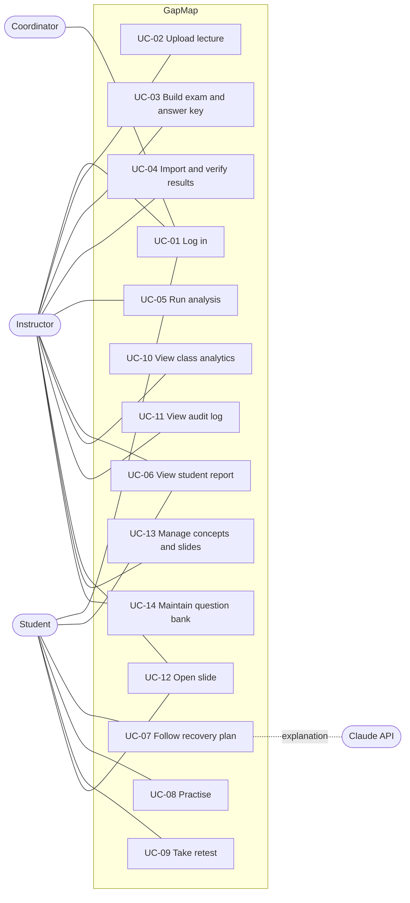

# Use cases

## Actors

| Actor | Type | Description |
|---|---|---|
| Instructor | Primary | Owns a course: uploads lectures, builds exams, imports and approves results, reads reports and analytics |
| Student | Primary | Enrolled in a course: reads their own report, follows the recovery plan, practises, takes the retest |
| Coordinator | Primary | Reads course-level information; no access to individual students |
| Admin | Primary | Instructor rights on every course |
| Claude API | Secondary, optional | Writes a grounded explanation of a concept from its approved slides |

## Use case diagram (as built)

Course creation is not a use case of the built app; the seed script creates the course and its
enrolments (see [Scope-and-Limitations](../01-Introduction/Scope-and-Limitations.md)).

## UC-13 Manage concepts and slides

| | |
|---|---|
| Actor | Instructor |
| Precondition | The course has at least one lecture uploaded |
| Main flow | 1. Course page → **Manage concepts and slides**. 2. **New concept**: name and description. 3. **Find slides**: GapMap lists the course's pages that match the concept's words, best first, each with the words it matched. 4. The instructor opens a page to check it and clicks **Approve**. 5. The slide joins the concept's approved slides and appears in reports at once |
| Alternative 3a | No page matches: **Show all pages** lists every page so any can be approved |
| Alternative 5a | The instructor clicks **Remove** on an approved slide: students are no longer sent to it |
| Exception | Deleting a concept that exam questions, the question bank or recovery plans use is refused with the reason; renaming is allowed |
| Postcondition | Reports use the new slides immediately; existing recovery plans change when the analysis is re-run. Every change is in the audit log |

## UC-14 Maintain the question bank

| | |
|---|---|
| Actor | Instructor |
| Trigger | A concept needs more or better practice or retest questions, or an AI draft is waiting |
| Main flow | 1. Concepts page → the concept's **Question bank** link. 2. Reviews *Waiting for review*, *Practice* and *Retest*, each question with its key and source slide. 3. **New question**: practice or retest, the question, options, the correct one, and the slide that explains it. 4. Saves: the question is approved and served at once |
| Alternative 2a | An AI draft is waiting: the instructor edits it if needed and clicks **Approve** |
| Alternative 3a | The question matches an exam question or another item of the concept: refused, so the retest doesn't measure memorisation (BR-10) |
| Alternative 4a | **Withdraw** stops serving a question without deleting it |
| Exception | A question a retest has used can't be edited or deleted, because that would change the retest's results; it can be withdrawn |
| Postcondition | Practice serves approved practice questions; new retests draw 3 approved retest questions per weak concept. Every change is in the audit log |

## UC-04 Import and verify results

| | |
|---|---|
| Actor | Instructor |
| Precondition | The exam's answer key is approved |
| Trigger | The instructor has the results file |
| Main flow | 1. Opens the exam → **Import results**. 2. Uploads a `.csv` or `.xlsx` file. 3. GapMap validates every row and shows the counts: rows, students, to fix, warnings. 4. The instructor filters **To fix**, edits or deletes each invalid row. 5. Reviews **Warnings** (kept, not blocking). 6. Clicks **Approve results**. 7. GapMap creates the submissions and answers and logs the approval |
| Alternative 3a | A required column is missing or the file type is wrong: the whole file is rejected with a message that names the problem (TC-06, TC-04) |
| Alternative 6a | Rows with errors remain: **Approve** is disabled until they are fixed or deleted |
| Alternative 6b | The instructor clicks **Reject**: nothing is imported |
| Postcondition | Approved answers exist; the exam is ready for analysis. Official scores are stored unchanged (BR-01) |

## UC-05 Run analysis

| | |
|---|---|
| Actor | Instructor |
| Precondition | Results are approved |
| Main flow | 1. Clicks **Run analysis** on the course page. 2. GapMap scores every answer against the key, computes each student's performance per concept, records a likely cause for each wrong answer, and creates a recovery plan for every student with a weak concept. 3. Shows the student results table |
| Alternative 1a | No approved results: analysis is refused with a message (TC-19) |
| Postcondition | Reports and plans are available to students. A re-run rebuilds diagnoses and plans, except a plan whose student has already taken a retest, which is kept |

## UC-06 View student report

| | |
|---|---|
| Actors | Instructor (any student in their course), student (their own) |
| Main flow | 1. Opens the report. 2. Sees the score, each concept's percentage, question count and status (needs review / on track / not enough data), the approved slides for each weak concept, and every question with the student's answer, the correct answer and the likely cause with its evidence |
| Alternative | A concept with no approved slide shows no source rather than an invented one (TC-12) |
| Exception | A student opening another student's report, or a coordinator opening any report, is denied (TC-02, TC-27) |

## UC-07 Follow recovery plan

| | |
|---|---|
| Actor | Student |
| Precondition | The student has at least one weak concept |
| Main flow | 1. Opens **My plan**. 2. Sees the weak concepts, weakest first, each with its slides and a practice task. 3. If AI is on, reads a short explanation that cites slide pages. 4. Opens a slide and marks it as reviewed. 5. Goes on to practice (UC-08) or the retest (UC-09) |
| Alternative 3a | AI is off or fails: the explanation card is hidden; the rest of the plan is unchanged (TC-18) |

## UC-08 Practise

| | |
|---|---|
| Actor | Student |
| Main flow | 1. Opens practice for a concept. 2. Answers an approved practice item and clicks **Check**. 3. Sees whether it was right, the correct answer, and a link to the slide that explains it. 4. Clicks **Done practising**: the task is marked complete (TC-14) |
| Rule | Only approved practice items are served, without their answer keys (TC-25) |

## UC-09 Take retest

| | |
|---|---|
| Actor | Student |
| Main flow | 1. Clicks **Take the retest**. 2. Answers 3 new items per weak concept, drawn from retest-only items (BR-10). 3. Submits once. 4. Sees each concept's exam % and retest %, the change in percentage points, and a note that this is an early sign, not proof |
| Alternative 1a | A started retest is resumed with the same questions after a page refresh |

## UC-10 View class analytics

| | |
|---|---|
| Actor | Instructor |
| Main flow | 1. Opens **Class analytics**. 2. Sees concepts suggested for re-teaching, with the error rate, the number of students below the threshold, and the most common wrong answer with its likely cause. 3. Sees wrong-answer rates by concept and by question, always with counts |
