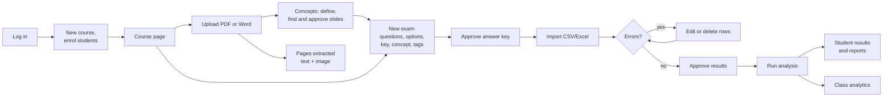
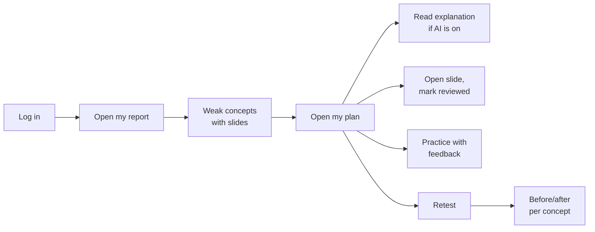
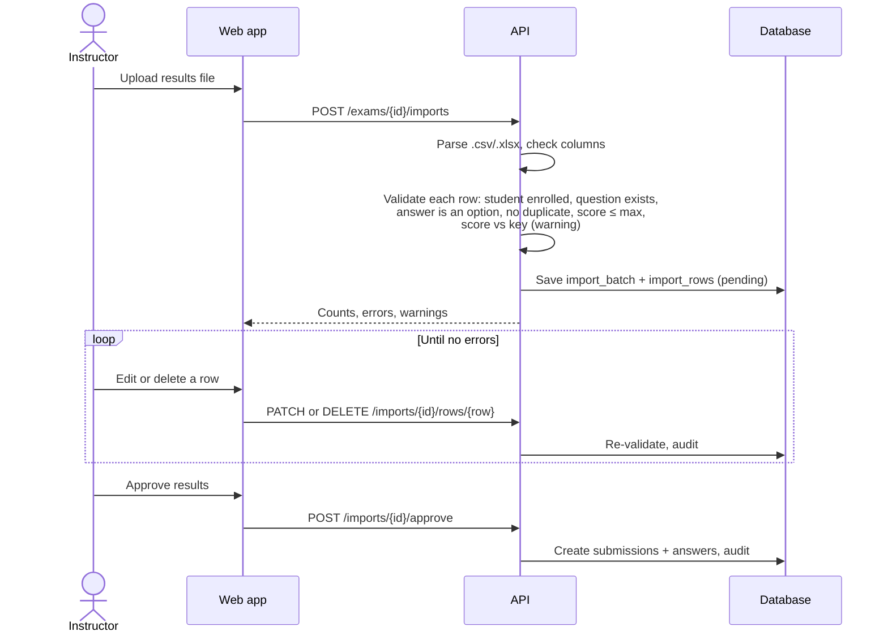
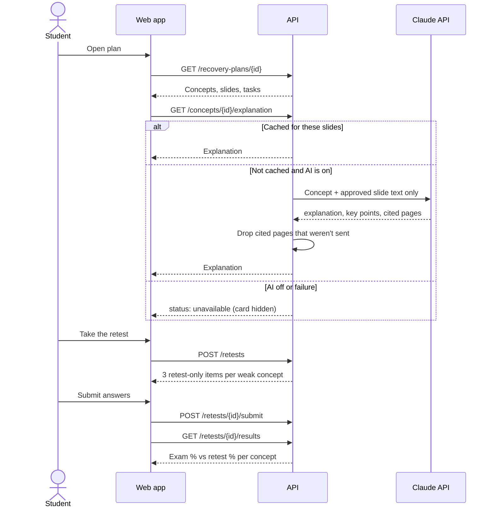

# Workflows

The plan's workflows (Section 7) as they run in the built system. Steps the plan describes but the app
doesn't do are marked.

## Instructor

Every step runs in the app. Student accounts themselves come from the seed.

## Student

## Course ingestion

Upload → check the type (.pdf or .docx) and size (25 MB) → Word is converted to PDF → each page's
text and title are extracted and the page is rendered to an image (PyMuPDF) → one `slide_chunks` row
per page → status `ready`, or `failed` with the reason.

Concept→slide suggestions use keyword matching on each page's title and text (name words count more
than description words, title matches double). Not built: chunking below page level, embeddings.

## Results import and verification

Analysis reads only `answers`, which exist only after approval, so unapproved data can't reach it
(ADR 0001 §1).

## Analysis

Approved answers → compare with the key → group by the question's concept → percentage per concept
with question count → status (weak if under 60% on 2 or more questions) → likely cause from the tag on
the chosen wrong option → save a diagnosis per wrong answer → create a recovery plan per student with
weak concepts, with up to 3 approved slides per concept plus a practice task.

Slides come only from the instructor-approved concept→slide mapping. The plan's fallback to semantic
search is not built.

## Recovery and retest

## Class analytics

Approved answers → wrong-answer rate per concept and per question, with counts → students below the
threshold per concept → most common wrong option and its tag → concepts at or above a 40% error rate
are suggested for re-teaching, with that evidence.
