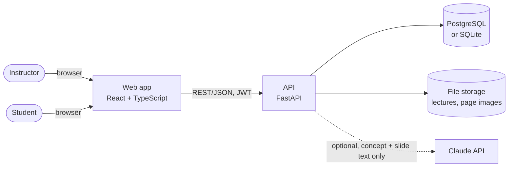
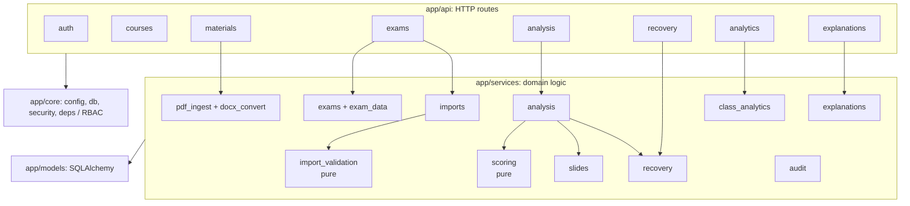
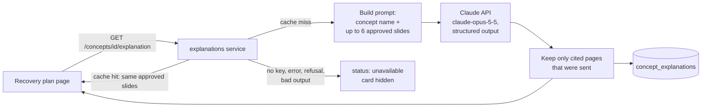

# Architecture

## Context and goals

GapMap serves two kinds of users, instructors and students, from one web app. The design goals,
in order:

1. **One reliable end-to-end journey** for the demo (plan Section 24).
2. **A deterministic core.** Scoring, diagnosis, slide links and the question bank work with no AI
   service (NFR-05).
3. **Nothing unverified reaches a student.** Imports, slide mappings and bank questions all need
   approval.
4. **Small and reproducible.** One backend, one database, one `docker compose up` (NFR-08, NFR-11).

## System context

## Containers (Docker Compose)

| Service | Image | Role |
|---|---|---|
| `db` | `pgvector/pgvector:pg16` | PostgreSQL 16 with a health check. pgvector is installed but unused (embeddings are P1) |
| `backend` | `python:3.12-slim` | FastAPI on port 8000; Swagger UI at `/docs` |
| `frontend` | `node:24-alpine` | Vite dev server on port 5173; proxies `/api` to the backend |

Volumes: `pgdata` (database), `storage` (uploaded lectures and rendered page images). `data/` is
mounted into the backend for the sample CSVs and template.

## Backend: a modular monolith

Routes are thin. They check authentication and roles, then call a service. Services hold the domain
logic. The two most rule-heavy pieces, scoring and import validation, are pure functions with no
database access, so they are tested in isolation.

| Module (plan 9.3) | Built as |
|---|---|
| auth | `api/auth.py`, `core/security.py` (bcrypt, JWT), `core/deps.py` (current user, roles, course access) |
| courses, materials | `api/courses.py`, `api/materials.py`, `services/pdf_ingest.py`, `services/docx_convert.py` |
| concepts | Models only; concepts and mappings are seeded |
| exams, imports, verification | `api/exams.py`, `services/exams.py`, `services/imports.py`, `services/import_validation.py` |
| analysis | `api/analysis.py`, `services/analysis.py`, `services/scoring.py` |
| retrieval | `services/slides.py`: approved mappings only, no vector search |
| recovery, question_bank | `api/recovery.py`, `services/recovery.py` |
| analytics | `api/analytics.py`, `services/class_analytics.py` |
| audit | `services/audit.py`; screen served by `api/explanations.py` |
| AI explanations (P1) | `api/explanations.py`, `services/explanations.py` |

## Frontend

React 19, TypeScript, Vite, Tailwind CSS 4, React Router 7 and TanStack Query. API types are
generated from the backend's OpenAPI schema (`npm run gen:api`), so the frontend and backend share
one contract. Pages live in `src/pages/`; reusable pieces in `src/components/` and
`src/features/`. The 12 routes are listed in [UI-Wireframes](UI-Wireframes/README.md).

## Key decisions

| Decision | Why | Trade-off |
|---|---|---|
| Modular monolith, not microservices | Fastest to build and run for a 4-person, 10-day project (plan 9.1) | Modules share one process and database |
| Import rows are staged in `import_rows`; `answers` are created only on approval | Analysis can never see unapproved data, without extra checks (FR-23) | One more table than the plan's ERD |
| Likely cause comes from error types the instructor tags on wrong options | Works without an LLM; explainable; the instructor stays in control (FR-27, BR-07) | Needs the instructor to tag options |
| Slides come from approved concept→slide mappings, not live search | Deterministic, fast, never invents a source (FR-35) | Suggesting slides for new concepts is manual until embeddings are added |
| One explanation per concept, cached, not per student | No student data can enter the prompt (BR-12); near-zero cost after the first request | Explanations are not personalised to a student's wrong answer |
| `create_all` plus a reset seed, no migrations | The schema changed daily; there is no production data | Add Alembic before any real deployment |
| SQLite for tests and local runs, PostgreSQL in Docker | Tests run in seconds with no services; models stay portable | CI also runs the smoke test on PostgreSQL to catch differences |

Full reasoning: [../../decisions/0001-hackathon-decisions.md](../../decisions/0001-hackathon-decisions.md).

## The AI component

- **Grounding:** the system prompt tells the model to use only the slides given, to treat slide text
  as data rather than instructions (prompt-injection mitigation, plan 10.4), and to say so if the
  slides don't explain the concept.
- **Structured output:** `explanation`, `key_points`, `cited_pages`, so citations can be checked.
- **Cache:** one row per concept, keyed by the set of approved slides it was written from; it is rebuilt when that set changes.
- **Refusals:** if a safety classifier declines, the request is retried on Anthropic's recommended
  fallback model.

## Security

- Passwords are hashed with bcrypt. JWT access tokens are signed (HS256) and expire after 8 hours.
  The secret comes from `.env`, which is never committed.
- Every route checks the role and course access. Student-level endpoints deny coordinators.
- Uploads are checked for type and size (25 MB lectures). Lecture text and the AI output are
  rendered as text, never as HTML.
- Audit log of approvals and edits.
- Not done for the demo: TLS, rate limiting, account lock-out, data-retention jobs. See the
  [Deployment-Guide](../07-Deployment/Deployment-Guide.md).
