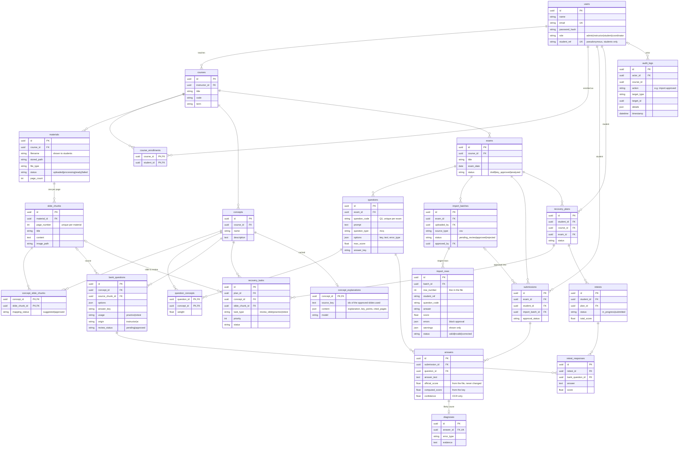

# Entity-relationship diagram (as built)

Generated from `backend/app/models/`. 22 tables. Every `id` is a UUID. Enums are stored as plain
strings so the same schema runs on PostgreSQL and SQLite.

## Differences from the plan's ERD (Section 8.7)

| Change | Why |
|---|---|
| **Added `import_rows`** | Rows under review need a home before they become answers (ADR 0001 §1) |
| **Added `concept_explanations`** | One cached AI explanation per concept (ADR 0001 §5) |
| **Added `audit_logs.course_id`** | Lets the audit screen list a course's actions |
| `questions.options` holds an `error_type` per option | Source of the likely cause (ADR 0001 §2) |
| `recovery_tasks.priority`, `completed_at` | Order the plan; record completion (FR-36, FR-40) |
| `slide_chunks.image_path`; no `embedding` column | Page images for the slide viewer; embeddings are P1 |
| No `ConceptPerformance` table | Per-concept scores are computed on demand; they take milliseconds on the demo data |
